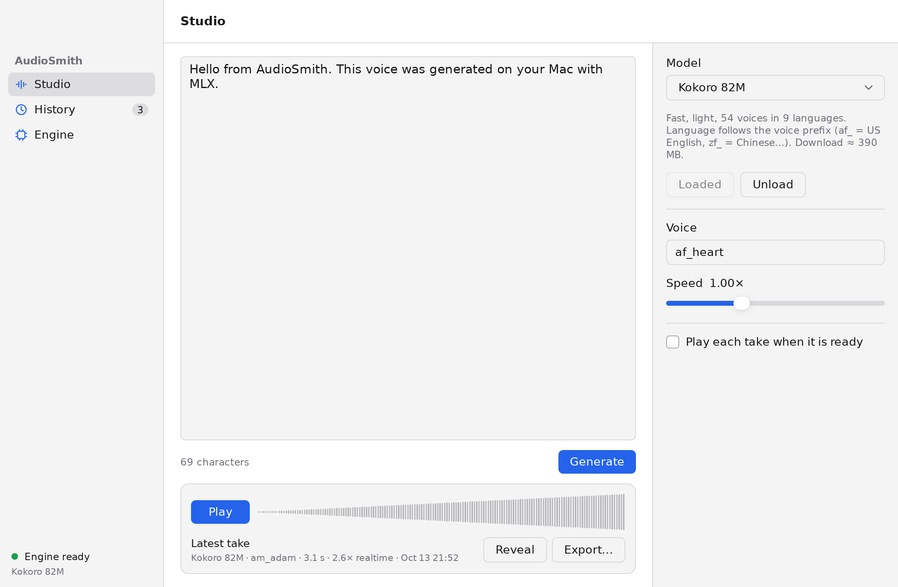
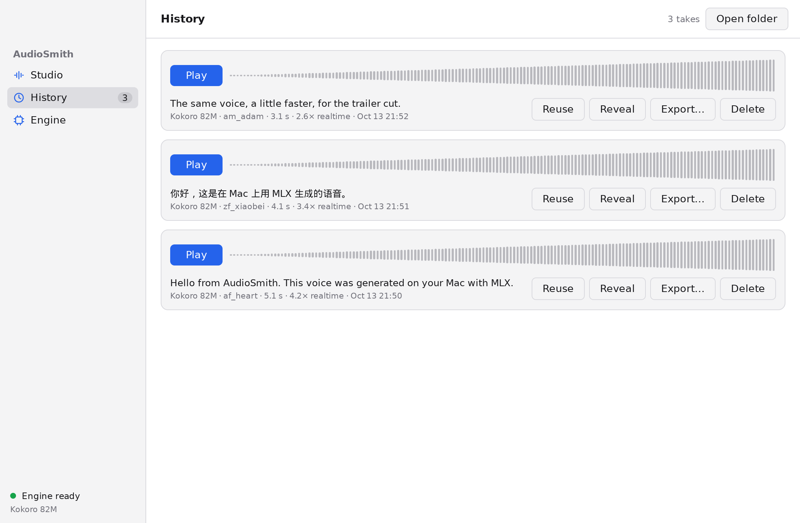
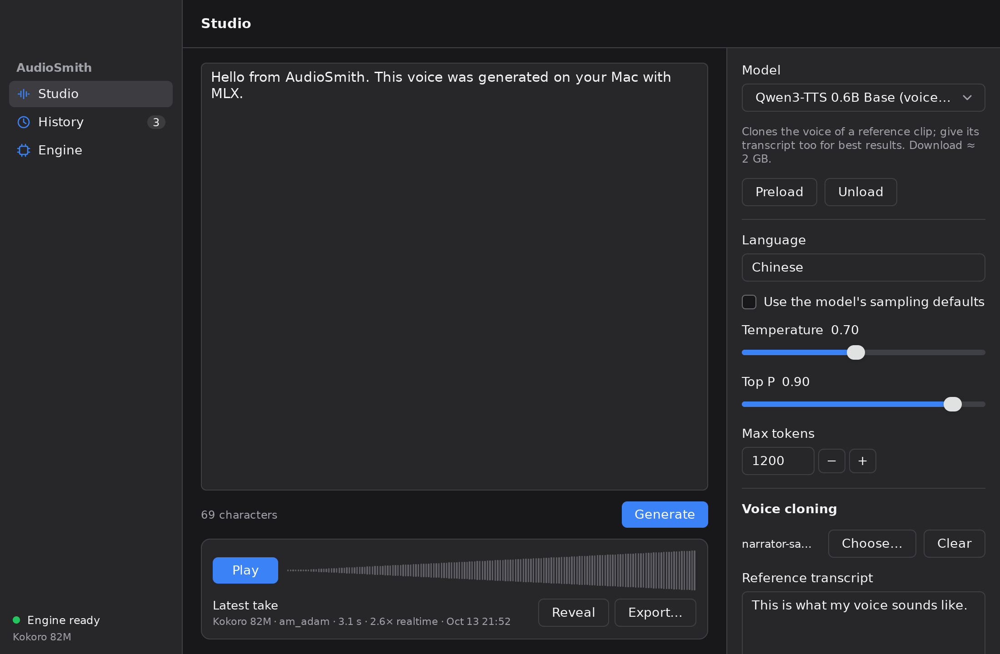

# AudioSmith

A TTS workbench for macOS on Apple silicon. Write a script, pick a model and a voice, generate takes locally on the GPU, then listen to them, compare them and export them.

- **UI**: [MyGo](https://mygo.egoist.dev/) native UI, written in Go (`*.go`).
- **Speech**: `audiosmith-engine`, a Swift helper on [mlx-audio-swift](https://github.com/Blaizzy/mlx-audio-swift) (the [hehehai fork](https://github.com/hehehai/mlx-audio-swift) Voxt uses) in `engine/`, which runs the models with MLX.

## MVP features

| Area | What it does |
|---|---|
| Studio | Script editor; model / voice / language / speed / sampling controls that change with the model; voice cloning from a reference clip; Generate (⌘↩) and Cancel; live progress; the latest take with its waveform (click to seek), plus Play, Reveal and Export |
| Models | Kokoro 82M (54 voices, 9 languages including Chinese), Qwen3-TTS 0.6B CustomVoice / Base (clone), Marvis 250M, Soprano 80M, or any Hugging Face repo mlx-audio-swift loads. Preload and Unload |
| History | Every take is stored with the settings that made it (model, voice, speed, RTF…). Play, Reuse (loads them back into the studio), Reveal, Export, Delete |
| Engine | Status, PID, loaded model, paths, the last stderr lines after a crash, Restart |

Data:

- Takes: `~/Library/Application Support/AudioSmith/clips/*.wav`, indexed by `history.json`
- Models: the Hugging Face cache, `~/.cache/huggingface/hub` (shared with the Python tools; `HF_HUB_CACHE` / `HF_HOME` override it, and `HF_TOKEN` is passed through)
- Engine log: `~/Library/Logs/AudioSmith/engine.log`

## Architecture

```
┌──────────────── AudioSmith.app ────────────────┐
│ Go + MyGo native UI (Metal)                     │
│  view.go   studio / history / engine pages      │
│  app.go    state and actions (main thread)      │
│  engine.go child process, JSON lines            │──stdin──▶ ┌───────────────────────────┐
│  clips.go  history, waveform peaks              │◀─stdout── │ audiosmith-engine (Swift) │
│  player.go playback (mygo/audio)                │           │ mlx-audio-swift + MLX     │
└─────────────────────────────────────────────────┘           │ writes WAV takes          │
                                                              └───────────────────────────┘
```

The two halves only share the protocol in [`engine/Sources/AudioSmithEngine/Protocol.swift`](engine/Sources/AudioSmithEngine/Protocol.swift): one JSON object per line (`load`, `synthesize`, `cancel`, `unload` → `ready`, `status`, `loaded`, `progress`, `done`, `cancelled`, `error`). The engine keeps one model loaded, runs one job at a time, and exits when the app closes its stdin. The engine's stdout carries only the protocol: it redirects everything else to stderr, which the app logs.

Why a helper process: MyGo is pure Go without cgo, and MLX is Swift/C++/Metal. A child process keeps the Go build cgo-free, keeps the UI alive when a model crashes or runs out of memory, and gives Unload a way to free the GPU memory.

## Build and run

Needs macOS 14+ on Apple silicon, Xcode 26 (Swift 6.2+), and Go 1.27.1 (`GOTOOLCHAIN=auto` downloads it).

```sh
scripts/build-engine.sh         # xcodebuild → resources/darwin-arm64/engine/  (about 4 min the first time)
go tool mygo dev                # run with live reload
go tool mygo build              # build/darwin-arm64/AudioSmith.app and a .dmg
```

The engine has to be built with `xcodebuild`, not `swift build`: only Xcode compiles MLX's Metal kernels into `mlx-swift_Cmlx.bundle/…/default.metallib`. `build-engine.sh` stages the executable and its resource bundles, and MyGo copies them into `AudioSmith.app/Contents/Resources/engine/` and signs them.

Smoke-test the engine without the app:

```sh
resources/darwin-arm64/engine/audiosmith-engine --text "Hello" --voice af_heart --output /tmp/hello.wav
```

`AUDIOSMITH_ENGINE=/path/to/audiosmith-engine` makes the app use another engine build.

### Developing from Linux

The UI and its tests are plain Go and run anywhere:

```sh
CGO_ENABLED=0 go test ./...     # views run headless in ui.Tester; the engine is faked
go tool mygo vet .
```

`scripts/mac.sh` mirrors the project to a Mac over SSH (`MAC_HOST`, default `mac-air`) and runs a command there:

```sh
scripts/mac.sh scripts/build-engine.sh
scripts/mac.sh go tool mygo build
```

## Versions

The engine uses the dependency set Voxt validated, locked in `engine/Package.resolved` (builds use it strictly):

| Dependency | Pin |
|---|---|
| [hehehai/mlx-audio-swift](https://github.com/hehehai/mlx-audio-swift) | `2a6e75d` (upstream + Voxt fixes) |
| mlx-swift | `0.31.6` |
| mlx-swift-lm | `c6446cf` |
| swift-transformers / swift-huggingface | `1.3.4` / `0.10.2` |

Keep them together. **Don't move to upstream mlx-audio-swift HEAD / mlx-swift 0.32.x yet**: MLX 0.32 makes Metal command encoders thread-local, while mlx-audio-swift builds graphs in Swift `Task`s that hop threads. Every generation then crashes with `There is no Stream(gpu, N) in current thread`. This was reproduced with Kokoro on macOS 26.

MyGo is pinned in `go.mod`; `go tool mygo` runs the CLI at that version.

## Tests

| Command | Where | What it covers |
|---|---|---|
| `CGO_ENABLED=0 go test ./...` | anywhere | Views in `ui.Tester` with a fake engine (generate, cancel, errors, crash + restart, per-model controls, preload/unload, history reuse/delete), the real process client against a stand-in script |
| `AUDIOSMITH_E2E=1 go test -run TestEndToEnd -v .` | Mac | The app's state driving the real engine: start, preload, English and Chinese takes, unload |
| `scripts/smoke-engine.sh` | Mac | The engine binary alone: three Kokoro takes |
| `AUDIOSMITH_SNAPSHOTS=/tmp/shots go test -run TestSnapshots .` | anywhere | Renders every page, light and dark, to PNG |





## Next steps

- Stream audio as it is generated (the engine already receives chunks) for a lower time to first sound
- Long scripts: split by paragraph into a queue of takes and join them
- A/B comparison of takes, ratings and notes
- STT round trip (MLXAudioSTT) to check pronunciation
- Model manager: downloaded models, sizes, delete
- Signing, notarization and auto-updates (`macos.signingIdentity`, `updates` in `mygo.json`)
