<p align="center">
  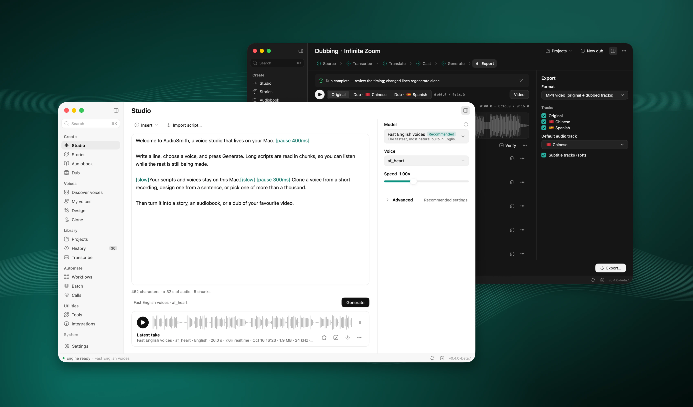
</p>

<h1 align="center">AudioSmith</h1>

<p align="center">
  <b>A voice studio that runs on your Mac.</b><br>
  Speech, voices, stories, audiobooks, dubbing, transcription and dictation, on Apple silicon.
</p>

<p align="center">
  <a href="https://github.com/hehehai/AudioSmith/releases"></a>
  
  
  <a href="LICENSE"></a>
</p>

<p align="center"><b>English</b> · <a href="README.zh-CN.md">简体中文</a></p>

AudioSmith turns text into speech, clones and designs voices, gives a story a cast, reads a book into an M4B, dubs a video into another language, transcribes a recording with who said what, and types what you say into any app. Every model runs on your Mac's GPU with [MLX](https://github.com/ml-explore/mlx): no account, no cloud service, no Python. It runs on your Mac, and once its models are downloaded it works offline.

[Features](#features) · [Install](#install) · [Models](#models) · [Privacy](#privacy) · [Build from source](#build-from-source) · [Licence](#licence-and-credits)

> **0.4.0-beta.1 is the first signed release, and it is a beta.** It is signed with a Developer ID, notarized by Apple and updates itself. Expect rough edges; see [Known limits](#known-limits).

## Features

### Studio

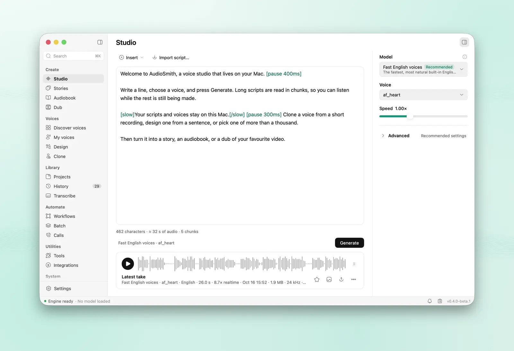

- **Write or import** a script (TXT, MD, DOCX, EPUB, SRT, VTT). Markup adds pauses (`[pause 400ms]`), pace (`[slow]`, `[fast]`), emphasis, spelling and one-off pronunciations (`[[word|say]]`).
- **Pick a model by what it is for:** Standard voices, Fast clone, High-fidelity clone, Voice design, Fast English voices, English clone or Multilingual all-rounder. The technical name is one click away.
- **Few controls:** the model, one Voice list and the speed. Everything else is under Advanced, filled with settings measured for each model.
- **Long scripts** render in chunks and play while they render. Text you did not change comes from a cache.
- **Export audio:** WAV or M4A, and MP3, FLAC or Opus with ffmpeg. Even out the loudness to −16, −18 or −23 LUFS, trim the silence, add tags, save the script and subtitles beside it.

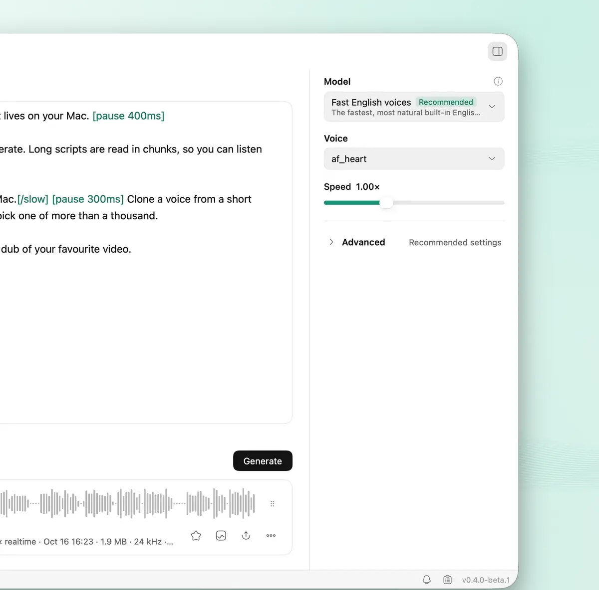

### Voices

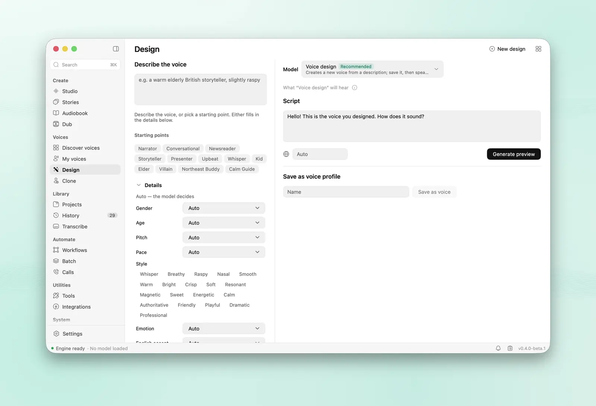

| Discover voices | My voices |
|---|---|
| 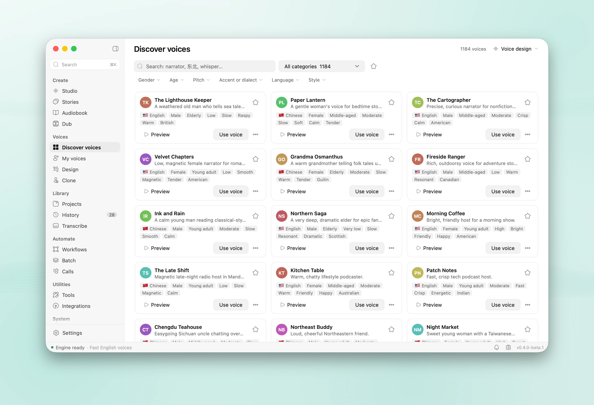 | 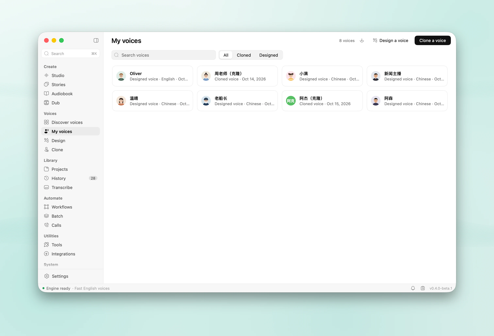 |

- **Discover** about 1,200 ready-made voices, preview them and save the ones you like.
- **Clone** a voice from a recording or from any audio or video file. AudioSmith picks the best stretch, transcribes it and removes the noise. A recorded consent statement marks a voice as your own.
- **Design** a voice from a sentence in English or Chinese ("a warm narrator in her thirties, calm and clear").
- **Portable voices:** a model's built-in speaker or a designed voice can be turned into a clone that every cloning model can speak with. It sounds close to the original, not the same, and says so.
- Voices are `.asvoice` files you can share. VoiceStudio's `.ovsvoice` files import too.

### Stories

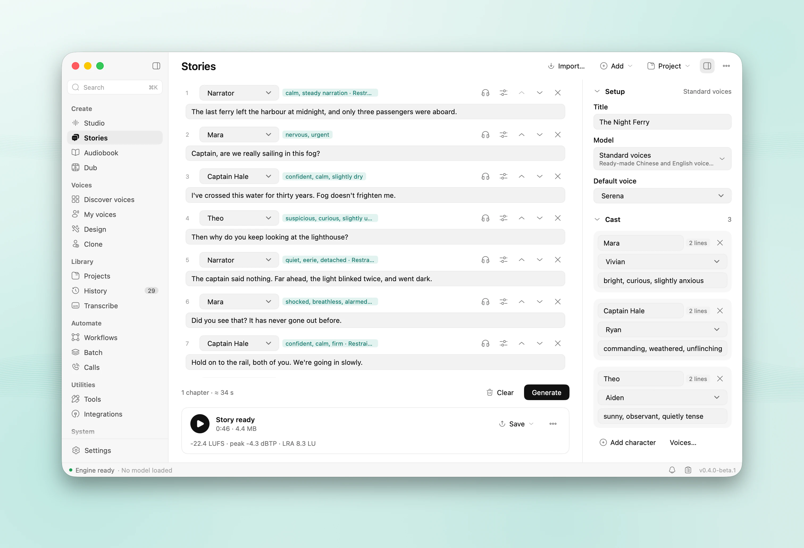

- **Write `Name: line`** and AudioSmith casts the characters. Stage directions such as `MOM (softly):` become the line's direction instead of being read out.
- **Dialogue that flows:** the gaps follow the conversation (Dialogue, Reading or Relaxed). A character's consecutive lines are said in one go, and each voice is brought to one loudness.
- **AI director:** the writing assistant (Qwen3 4B, on this Mac) fills in the scene, a persona for each character and a direction for each line. Models that take instructions hear them; the others read the lines as written, and the page says so.
- Export a WAV, an M4B, or one stem per character.

### Audiobook

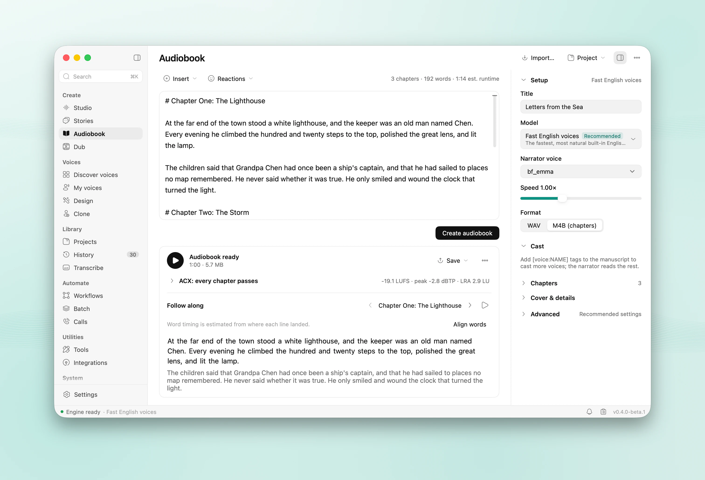

- **Import** an EPUB, TXT, Markdown or DOCX book. Chapters come from its headings.
- **Loudness** per chapter for ACX (Audible) or podcasts. A read-along player follows the text.
- **Export** an M4B with chapters, cover and tags, a cue sheet, or one file per chapter.
- **Resume** after quitting. After an edit, only the changed lines are rendered again.

### Dub

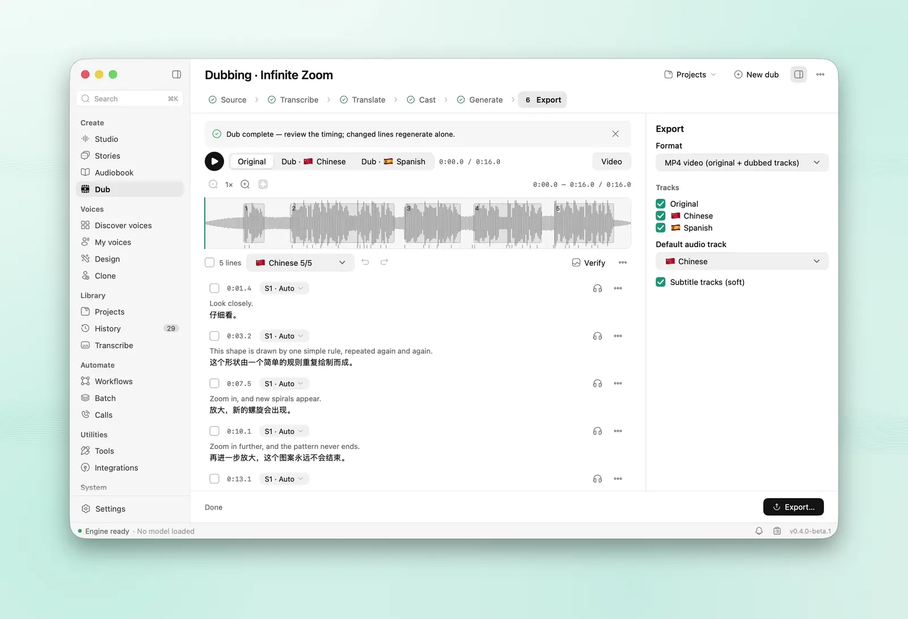

- **Drop in a video or audio file,** or paste a link (yt-dlp, which you turn on). New dubs are made in Chinese; when the video is already Chinese they switch to English. Add more languages as you like.
- **Four steps:**
  1. Separate the voices from the background (HTDemucs).
  2. Transcribe and tell the speakers apart (Transcription with speakers, or Qwen3-ASR with Sortformer).
  3. Translate with the local writing assistant, Ollama, a cloud model, DeepL, Google or Microsoft. A glossary keeps names right.
  4. Speak each line in its speaker's cloned voice, fitted to the original timing.
- **Edit** lines on a timeline, compare A/B, preview the video, and re-dub only what changed.
- **Export** an MP4 with one audio track per language and soft subtitles, or M4A, WAV, SRT, VTT, ASS and stems. Batch dubs a whole folder, and can watch one.

### Transcribe and dictation

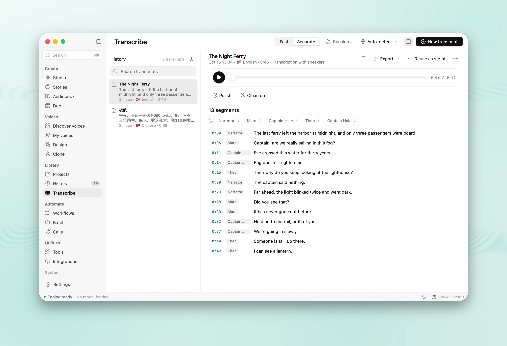

- **Transcribe** recordings and videos with word timings. Qwen3-ASR handles Chinese, English and 28 more languages; Whisper covers the rest and translates speech into English.
- **Transcription with speakers** says who says what (S1, S2…) in one pass; click a speaker to name it. Copy, TXT, SRT, VTT and JSON exports carry the names.
- **Dictation anywhere:** press ⌘⇧Space in any app, speak, and the text is typed where your cursor is, about 0.2–0.3 s after you stop. Your clipboard is kept. A menu bar icon and a small pill show when it listens.

### Workflows and batch

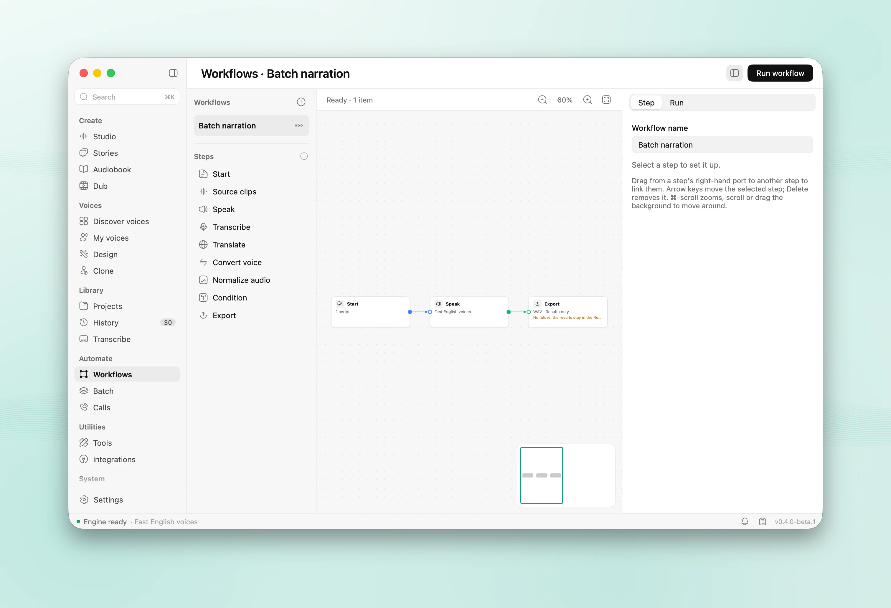

- **Workflows:** chain steps on a canvas (sources, speak, transcribe, translate, convert, even out, condition, export), start from a template, and run them over up to 50 inputs. A run continues after a restart.
- **Batch** queues dubs and watches a folder.

### For agents and scripts

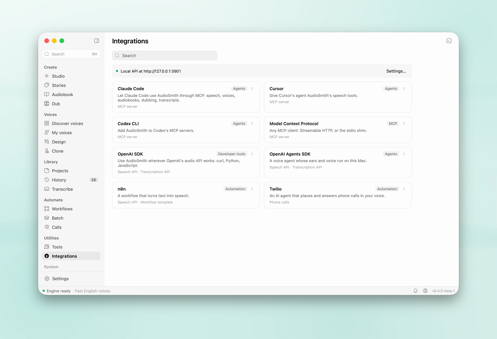

- **OpenAI-compatible API** on `http://127.0.0.1:3901/v1`: speech, transcriptions, translations, models and voices. Point any OpenAI SDK at it.
- **AudioSmith's own API** (`/api`) drives every page: voices, stories, audiobooks, dubs, batch, workflows, exports. Jobs report progress over SSE, and `/ws/tts` streams speech.
- **MCP server** over HTTP (`/mcp`) and stdio (`AudioSmith --mcp-stdio`), with 33 tools. Deleting needs `confirm: true`, and cloning needs consent.
- **Integrations page:** one prompt sets up Claude Code, Codex or Cursor (server and agent skill); there are snippets for n8n, curl, Python, JavaScript and the OpenAI Agents SDK.

```sh
curl http://127.0.0.1:3901/v1/audio/speech \
  -H 'Content-Type: application/json' \
  -d '{"model": "tts-1", "voice": "alloy", "input": "Build finished. All tests passed."}' \
  -o speech.wav
```

The full reference is [docs/local-api.md](docs/local-api.md), and `/docs` in the running app.

### And more

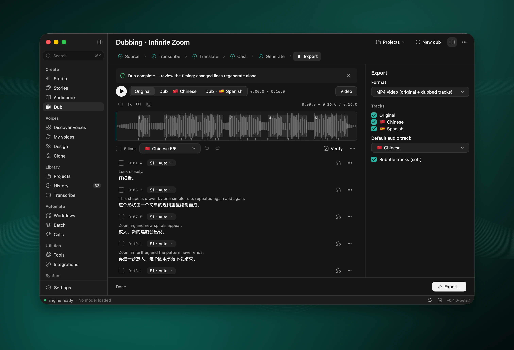

- **Tools:** compare voices A/B, speak a recording again in another voice, fit text to a duration, probe a file, check a watermark.
- **Invisible watermark:** generated audio carries an AudioSeal mark, on by default (Settings → Privacy), and Tools can detect it.
- **Calls:** an AI phone agent on your own Twilio account. It always says it is an AI, and uses only designed or consented voices. Off until you set it up.
- **The app:** Projects and History libraries, one job queue that resumes after a restart, the command palette (⌘K), ⌘1–9 for the main pages, light and dark themes, English and 简体中文.

## Install

**Requirements**
- macOS 15 or later, on Apple silicon (M1 or later).
- Memory: 8 GB runs the Fast pack; 16 GB is recommended; 24 GB runs the Quality pack (high-fidelity cloning, voice design, dubbing and the writing assistant).
- Disk: 1.3–17 GB for models, depending on the pack.

**Steps**
1. Download the DMG from [Releases](https://github.com/hehehai/AudioSmith/releases). The first release, 0.4.0-beta.1, is marked Pre-release.
2. Drag **AudioSmith** to Applications and open it. Releases are signed and notarized, so Gatekeeper lets them open; macOS only asks once to confirm an app from the internet.
3. The setup wizard checks your Mac (macOS, chip, memory, disk, network), suggests a model pack, and asks about privacy and dictation. You can skip the pack and download models later on the Models page.

| Pack | For | Download |
|---|---|---|
| **Fast** | built-in voices and dictation; any Mac | 1.3 GB in English, 2.8 GB in Chinese |
| **Balanced** | + cloning, word timings, noise removal; 16 GB | 4.3 / 5.8 GB |
| **Quality** | + high-fidelity cloning, voice design, dubbing, speakers, writing assistant; 24 GB | 13.4 / 14.9 GB |
| **Max** | + Multilingual all-rounder (non-commercial) and Whisper; 48 GB | 15.5 / 17.0 GB |

**Updates.** Once a day AudioSmith checks GitHub for a new version, shows its notes, and installs it when you say so. Updates are signed and checked before they install, and usually download only what changed. **AudioSmith → Check for Updates…** checks at once.

**Beta updates.** Settings → Diagnostics and about → **Receive beta updates**. It is on in a beta (such as 0.4.0-beta.1) and off in a release until you choose. Turning it off never goes back to an older version: a beta stays until a newer release is out.

**Downloads** come from huggingface.co or hf-mirror.com, whichever answers faster, through the system proxy. In mainland China, pick hf-mirror.com in **Settings → Network** if downloads stall.

**Permissions** are asked only when a feature needs them: the **Microphone** for recording a voice, dictation and live transcription, and **Accessibility** for dictation to type into other apps.

## Models

AudioSmith names models for what they do. Their technical names, sizes and licences are in each model's Details on the Models page.

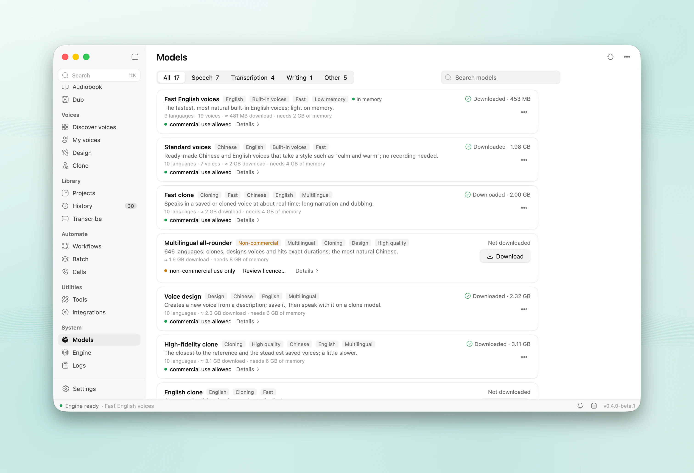

| In the app | Model | What it does | Licence |
|---|---|---|---|
| **Standard voices** | Qwen3-TTS 0.6B CustomVoice | built-in Chinese and English speakers, with directions | Apache-2.0 |
| **Fast clone** | Qwen3-TTS 0.6B Base | quick voice cloning | Apache-2.0 |
| **High-fidelity clone** | Qwen3-TTS 1.7B Base | the most faithful cloning | Apache-2.0 |
| **Voice design** | Qwen3-TTS 1.7B VoiceDesign | voices from a description | Apache-2.0 |
| **Fast English voices** | Kokoro 82M | natural English voices; light | Apache-2.0 |
| **English clone** | Chatterbox Turbo | fast English cloning | MIT |
| **Multilingual all-rounder** | OmniVoice | 600+ languages, cloning, design, exact durations | **CC BY-NC 4.0: non-commercial**; asks you to accept it first |
| **Chinese & English transcription** | Qwen3-ASR 0.6B | transcription and dictation, 30 languages | Apache-2.0 |
| **Multilingual transcription** | Whisper large-v3 turbo | other languages; speech into English | MIT |
| **Transcription with speakers** | MOSS-Transcribe-Diarize 0.9B | who says what, in one pass | Apache-2.0 |
| **Writing assistant** | Qwen3 4B Instruct 2507 | translation, clean-up, the AI director | Apache-2.0 |
| Word timing · Speech detection · Noise removal | Qwen3-ForcedAligner 0.6B · Silero VAD · DeepFilterNet 3 | | Apache-2.0 · MIT · MIT/Apache-2.0 |
| Voice separation · Speaker turns | HTDemucs · Sortformer (fallback, ≤ 4 speakers) | | MIT · NVIDIA Open Model License |
| Invisible watermark | AudioSeal | | MIT |

Measured on a MacBook Air M4 with 24 GB:

| What | Result |
|---|---|
| Dictation (Qwen3-ASR) | 0.2–0.3 s after you stop speaking |
| High-fidelity clone | about real time: 940 Chinese characters → 3.5 min of audio in about 3¼ min |
| Standard voices | about 1.7× real time |
| Transcription with speakers | a 10-minute recording in about 4 minutes |
| Writing assistant | 36–40 tokens/s |

## Privacy

- **Speech is made and recognised on your Mac.** The engine never connects to the network; it loads the models the app downloaded.
- **AudioSmith connects only for:** model downloads (Hugging Face or its mirror), ffmpeg and yt-dlp when you download them, videos from links you paste, a cloud writing or translation provider only if you set one up, and the daily update check (nothing about you is sent).
- **No analytics:** no usage data, crash reports or identifiers, and no setting to turn them on.
- **The Local API listens on 127.0.0.1** unless you share it on your network (with a PIN).
- **Keep text on this Mac:** one switch limits writing help and translation to local models.
- Your library is in `~/Library/Application Support/AudioSmith` (it can move to another disk). Keys live in the login Keychain.

## Build from source

You need Xcode 26 (Swift 6.2 or later) and Go 1.27.1 (`GOTOOLCHAIN=auto` downloads it).

```sh
scripts/fetch-engine-deps.sh    # upstream mlx-audio-swift + AudioSmith's patches
scripts/build-engine.sh         # the Swift engine (xcodebuild; about 4 min the first time)
go tool mygo dev                # run with live reload
go tool mygo build              # build/darwin-arm64/AudioSmith.app and a DMG
```

- The UI is Go with [MyGo](https://github.com/egoist/mygo). The models run in a Swift helper, `audiosmith-engine`, on [mlx-audio-swift](https://github.com/Blaizzy/mlx-audio-swift) and mlx-swift.
- `CGO_ENABLED=0 go test ./...` runs the whole UI headless on any OS, with the engine faked; `scripts/mac.sh` builds and tests on a Mac from Linux.
- More: [architecture](docs/architecture.md), [engine protocol](docs/protocol-v2.md), [Local API and MCP](docs/local-api.md), [releasing](docs/release.md).

## Known limits

- **Beta.** 0.4.0-beta.1 is the first signed release.
- **ffmpeg is optional and not bundled.** Without it AudioSmith reads and writes WAV, AIFF, M4A, MOV and MP4, and reads MP3. With it (Homebrew's, or one you choose) it also exports MP3, Opus and FLAC, reads WebM and MKV, and burns subtitles into videos.
- **Dictation** types the text when you stop, not word by word.
- **The interface** is in English and Simplified Chinese.
- **The watermark** does not survive time-stretching beyond about ±5 %, so dubs are marked after fitting.
- **Calls** need your own Twilio account and a public tunnel.
- Builds you make yourself are ad-hoc signed: they don't update themselves, and macOS forgets their Accessibility permission after each rebuild.

## Licence and credits

AudioSmith is [Apache-2.0](LICENSE). Model weights keep their own licences (see [Models](#models)); OmniVoice's is non-commercial.

- Models by the Qwen team (Qwen3-TTS, Qwen3-ASR, Qwen3 4B), hexgrad (Kokoro), Resemble AI (Chatterbox), k2-fsa (OmniVoice), OpenMOSS (MOSS-Transcribe-Diarize), OpenAI (Whisper), Meta (HTDemucs, AudioSeal), NVIDIA (Sortformer), Silero and DeepFilterNet. MLX conversions by mlx-community and others.
- Runs on [MLX](https://github.com/ml-explore/mlx), [mlx-swift](https://github.com/ml-explore/mlx-swift) and [mlx-audio-swift](https://github.com/Blaizzy/mlx-audio-swift).
- The interface is built with [MyGo](https://github.com/egoist/mygo) (MIT).
- Icons: [Solar](https://icon-sets.iconify.design/solar/) by 480 Design, CC BY 4.0 (see [NOTICE](NOTICE)).
