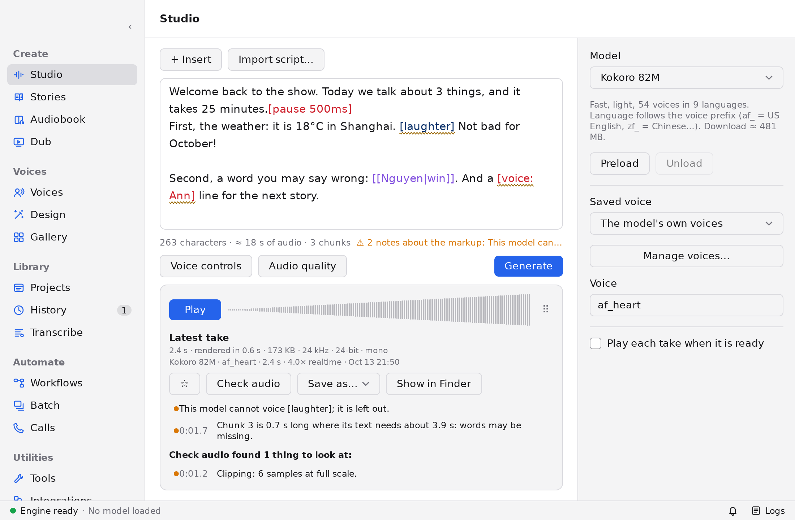
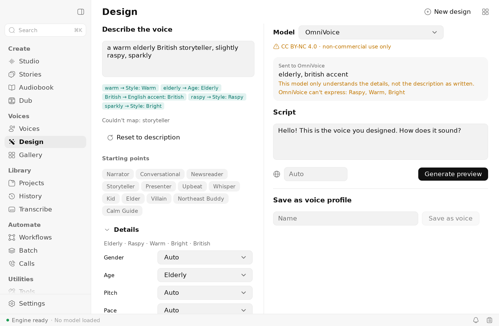
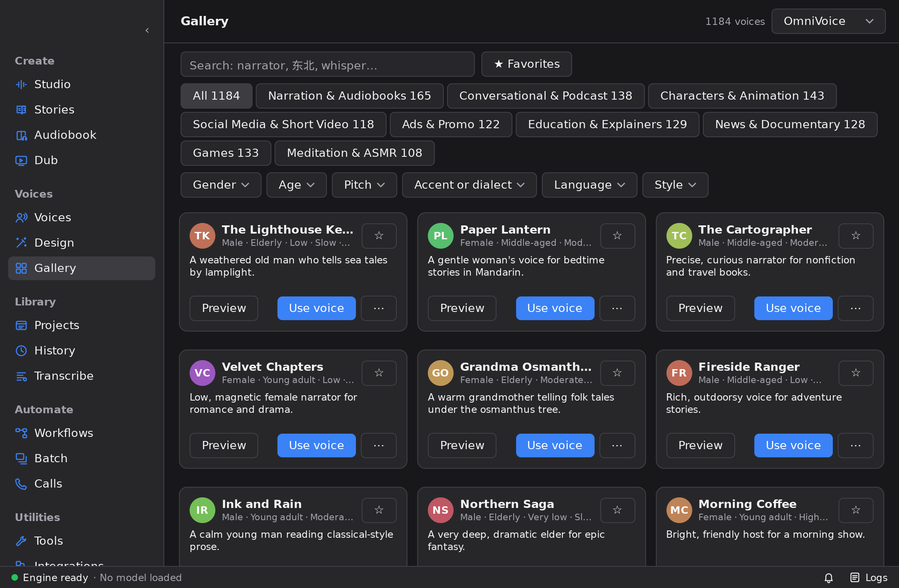
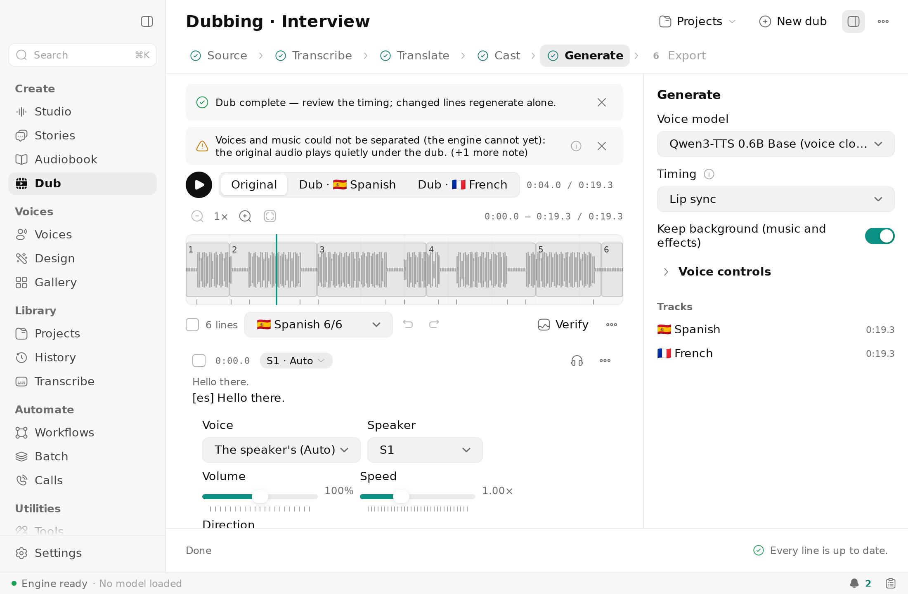
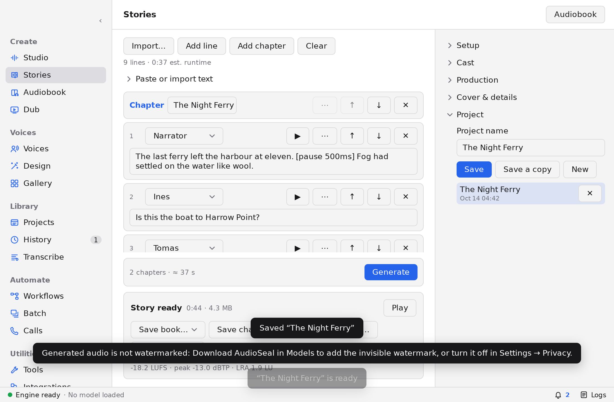
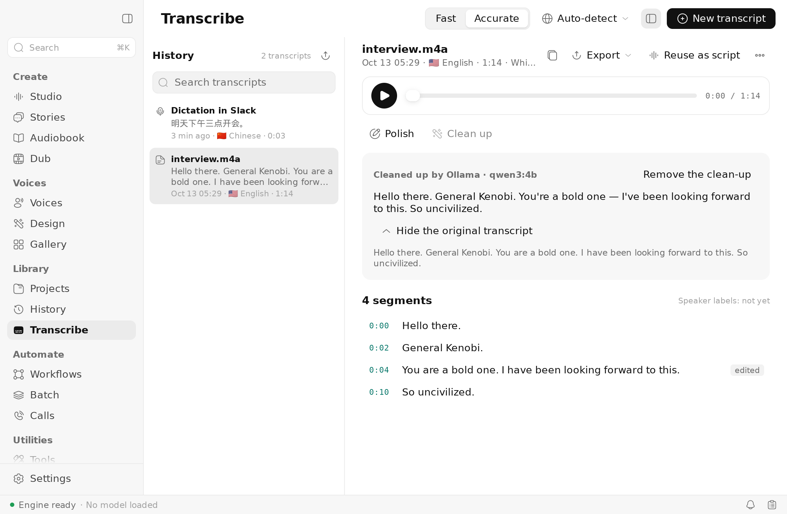
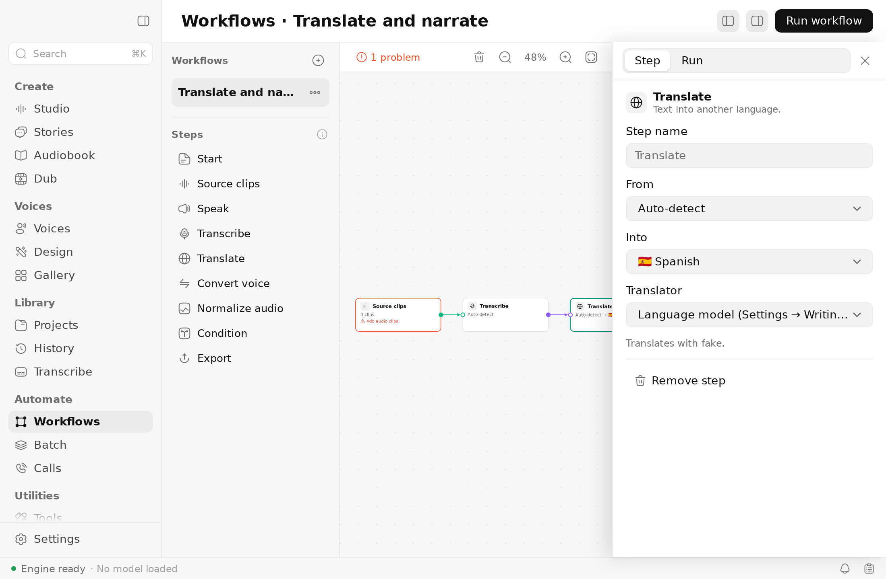
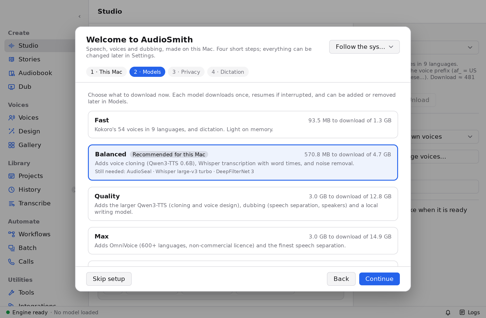
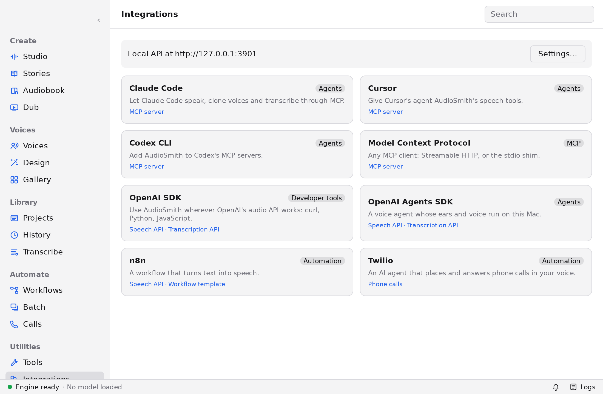

# AudioSmith

**English** · [简体中文](README.zh-CN.md)

A local voice studio for macOS on Apple silicon. It covers text to speech with saved, cloned and designed voices, stories and audiobooks, video dubbing, transcription and system-wide dictation. It also has a local OpenAI-compatible API, an MCP server and workflows.

Every model runs on the Mac's GPU with [MLX](https://github.com/ml-explore/mlx): no Python, no cloud account, nothing leaves the Mac unless you ask.

> **Status: 0.3 preview.** Feature parity with VoiceStudio's open-source edition is built and was verified in 0.2; 0.3 redesigns the interface. Expect rough edges, and see [Known limits](#known-limits).



## Install

**Requirements**
- macOS 15 or later on Apple silicon (M1 or later).
- 16 GB of memory is recommended. 8 GB works with the light models.
- About 1.3–15 GB of disk for models, depending on the pack (Fast 1.3 GB, Balanced 4.7, Quality 12.8, Max 14.9).

**Steps**
1. Download the DMG from [Releases](https://github.com/hehehai/AudioSmith/releases), or [build it](#build-from-source).
2. Drag **AudioSmith** to Applications.
3. Builds are ad-hoc signed for now, so macOS blocks the first launch. Do one of:
   - run `xattr -dr com.apple.quarantine /Applications/AudioSmith.app`, or
   - try to open it once, then click **Open Anyway** in **System Settings → Privacy & Security**. macOS 15 removed the right-click → Open shortcut.
4. The first run opens a setup wizard:
   - It checks this Mac: macOS, chip, memory, disk, network, permissions.
   - It suggests a **model pack** for your memory: Fast, Balanced, Quality or Max. You can skip it and download models later in **Models**.
   - It asks about privacy and dictation, then says hello with Kokoro.

Models come from huggingface.co or hf-mirror.com, whichever answers faster, through the system proxy. In mainland China, pick hf-mirror.com in **Settings → Network** if downloads stall.

**Permissions**, asked only when a feature needs them:
- **Microphone**: recording a voice reference, dictation, live transcription.
- **Accessibility**: dictation typing into other apps.

With ad-hoc builds, macOS forgets the Accessibility grant after each update. Re-tick AudioSmith in **System Settings → Privacy & Security → Accessibility**.

## Features

| Area | What it does |
|---|---|
| **Studio** | Script editor with markup: pauses, emphasis, `[slow]`/`[fast]`, pronunciation overrides `[[word\|say]]`, non-verbal tags. Imports TXT/MD/DOCX/EPUB/SRT/VTT. Controls follow the model: voice, language, speed, steps, guidance, target duration, seed. Long scripts render in chunks, with a streaming preview and a content-addressed chunk cache. Mastering ("Even out volume", −18 LUFS), a pronunciation dictionary, and a checker for clipping, clicks and long silences. Exports WAV 16/24/32-bit, plus MP3/FLAC/Opus with ffmpeg; drag a take out to Finder |
| **Discover voices, My voices, Design** | A voice library: clone from a recording or any audio/video file (best window, auto-transcript, denoise), with an own-voice consent recording. Design a voice from a description in English or Chinese (Qwen3-TTS VoiceDesign, OmniVoice tags). Discover voices: about 1,200 archetypes with previews. Portraits, tags, favourites, locked identities. `.asvoice` files, and VoiceStudio `.ovsvoice` import |
| **Stories, Audiobook, Projects** | Multi-voice scripts with automatic casting. Audiobooks from TXT/MD/EPUB/DOCX with chapters, per-chapter ACX or podcast loudness, a read-along player, M4B with chapters and cover, cue sheets and stems; resume after quitting, re-render only edited lines. A Projects library of everything made and exported |
| **Dub, Batch** | Video and audio dubbing: vocals/background separation (HTDemucs, Mel-RoFormer), speakers (Sortformer, up to 4), transcription with word times, translation (the local LLM, Ollama, cloud LLMs, DeepL, Google, Microsoft) with a glossary and fit-to-time rewrites. Lines are voice-cloned and fitted to the timing (WSOLA, or OmniVoice's exact duration). A timeline editor, A/B mixer, video preview and incremental re-dub. Exports MP4 with dubbed audio tracks and soft subtitles, M4A, WAV, SRT/VTT/ASS, stems. Batch queue and watch folder; URL import via yt-dlp (opt-in) |
| **Transcribe, Dictation** | Transcripts with word times (Whisper, Qwen3-ASR, Parakeet + forced alignment); exports SRT/VTT/TXT/JSON; clean-up with a language model. System-wide dictation (⌘⇧Space, toggle or hold) types into any app and keeps your clipboard. It has a floating pill and a menu bar icon. Qwen3-ASR answers in about 0.3 s |
| **Local LLM** | Qwen3 4B (default) or Gemma 4 E2B (light) in the engine: offline translation, dictation clean-up, glossary extraction, direction parsing. Routing goes local, then Ollama; cloud providers only when you pick one |
| **Local API, MCP, Integrations, Tools** | OpenAI-compatible `/v1` on `127.0.0.1:3901`: speech, transcriptions, translations, models, voices. A native `/api` with job events and WebSocket streaming. MCP over HTTP and stdio (`AudioSmith --mcp-stdio`). Setup pages for Claude Code, Cursor, Codex, n8n and the OpenAI SDKs. Tools: A/B voices, speech-to-speech, rate fit, direction, watermark check, file probe. See [docs/local-api.md](docs/local-api.md) |
| **Workflows** | A canvas of steps (sources, speak, transcribe, translate, convert, normalize, condition, export) run as resumable jobs over up to 50 inputs, with templates |
| **Calls** | An AI phone agent over your own Twilio account, outbound and inbound. It always speaks a disclosure and uses only designed or consent-verified voices; you can take over the call. Off until you set it up |
| **Models** | A pinned catalogue: TTS, speech recognition, alignment, VAD, separation, diarization, enhancement, LLMs, watermark. Downloads are resumable and checked, with licences reviewed before gated ones. Any Hugging Face repo mlx-audio-swift loads |
| **Responsible use** | An invisible AudioSeal watermark on generated audio (on by default; **Settings → Privacy**), with a detector in Tools and the API. Consent recordings for cloned voices. Licence gate for non-commercial models |
| **App** | Sidebar sections (Create, Voices, Library, Automate, Utilities, System), ⌘1–9, command palette (⌘K), shortcut sheet (?), ⌘E engine switch. A status bar with jobs and downloads, notifications, and a logs panel (⇧⌘L). Settings (a dialog, ⌘,) for storage, diagnostics, usage, network, privacy and appearance. English and 简体中文 UI |

Long work runs as jobs in one persistent queue: renders, dubs, transcripts, workflows, downloads. A job the app quit in the middle of continues at the next start. The engine never touches the network: it loads the snapshots the app downloaded.

| | |
|---|---|
|  |  |
|  |  |
|  |  |
|  |  |

## Models

Defaults, all checked against their upstream model cards. Every listed model passes the Mac smoke suite (`scripts/smoke-models.sh`).

| Task | Default | Others | Licence |
|---|---|---|---|
| Speech | Kokoro 82M (54 voices, 9 languages) | Qwen3-TTS 0.6B/1.7B (CustomVoice, clone, VoiceDesign), Chatterbox (23 languages), Chatterbox Turbo, MOSS-TTS-Nano, KittenTTS, Pocket TTS, Soprano, Marvis | Apache-2.0 / MIT / CC-BY-4.0 |
| Speech, 646 languages | — | **OmniVoice** (clone, design tags, exact duration) | **CC-BY-NC-4.0**: non-commercial, asks you to accept the licence first |
| Transcription | Whisper large-v3 turbo | Qwen3-ASR 0.6B (dictation default), Parakeet TDT v3 | MIT / Apache-2.0 / CC-BY-4.0 |
| Word timing, VAD, denoise | Qwen3-ForcedAligner, Silero VAD, DeepFilterNet 3 | | Apache-2.0 / MIT |
| Separation, speakers | HTDemucs, Sortformer (≤4 speakers) | Mel-RoFormer Kim vocal 2 | MIT / NVIDIA Open Model |
| Language model | Qwen3 4B Instruct 2507 | Gemma 4 E2B | Apache-2.0 |
| Watermark | AudioSeal (16 bits) | | MIT |

Marvis is listed as Apache-2.0 but was trained on Emilia, a non-commercial dataset. Check it before commercial use.

Measured on a MacBook Air M4 (24 GB):

| What | Result |
|---|---|
| Kokoro | renders about 5–6× real time: 10,000 Chinese characters → about 33 min of audio in under 6 min; re-rendering unchanged text is near-instant (chunk cache) |
| Qwen3-ASR dictation | 0.2–0.33 s for 5 s of speech |
| Qwen3 4B | 40 tokens/s |
| HTDemucs | 10× real time |
| Watermark | about 1 s per minute of audio |

## Known limits

- **Ad-hoc signing.** There is no notarization or auto-update yet.
- **ffmpeg is optional and not bundled.** macOS's AVFoundation reads and writes WAV, AIFF, M4A/AAC, MOV and MP4, and reads MP3. With an ffmpeg (Homebrew's, or a file chosen in **Settings → Audio tools**), AudioSmith also exports MP3/Opus/FLAC, reads WebM/MKV/VP9/AV1, and burns subtitles into videos.
- **Speakers.** Diarization finds up to 4 speakers.
- **Dictation** inserts the text when you stop, not word by word.
- **UI languages:** English and Simplified Chinese.
- **Watermark.** It does not survive time-stretching beyond about ±5 %. Dubs are therefore marked after fitting.
- **Calls** need your own Twilio account and a public tunnel (cloudflared or ngrok).

## Data

| What | Where |
|---|---|
| Library: takes, voices, projects, renders, dubs, transcripts, workflows, calls, settings, licences, jobs | `~/Library/Application Support/AudioSmith/audiosmith.db` (SQLite; backed up before each migration) |
| Files of the library | `…/AudioSmith/`: `clips/`, `voices/`, `references/`, `renders/`, `covers/`, `dubs/`, `transcripts/`, `workflows/`, `tools/` |
| Data folder elsewhere | **Settings → Storage → Move…**: copies, checks, switches; `…/AudioSmith/location.json` points to it |
| Caches | `~/Library/Caches/AudioSmith/` (waveforms, rendered chunks, previews) |
| Logs | `~/Library/Logs/AudioSmith/` (`audiosmith.log`, `engine-*.log`) |
| Models | the Hugging Face cache `~/.cache/huggingface/hub`, shared with the Python tools (`HF_HUB_CACHE` / `HF_HOME`, or **Settings → Models**) |
| Secrets | the login Keychain, service "AudioSmith": Hugging Face token, API key, LLM / translation / Twilio keys |

## Architecture

```
┌──────────────── AudioSmith.app (Go, no cgo) ────────────────┐
│ MyGo native UI (Metal) — *.go views per area                │
│ internal/services  takes, voices, longform, dubs, transcripts│
│                    workflows, calls (render pipeline)        │
│ internal/store     SQLite + FTS5 · internal/jobs  job queue  │
│ internal/api, mcp  Local API (OpenAI /v1, /api, WS), MCP     │
│ internal/hub       model downloads · internal/catalog        │
│ internal/text, doc, lang, dsp, voicedesign, gallery, llm,    │
│ translate, dub, workflow, telephony, ffmpeg …                │
│ internal/engine    supervisor + executors, protocol 2        │
└───────────────┬────────────────────────────┬─────────────────┘
        stdin/stdout JSON lines        (one Swift binary, three roles)
   ┌────────────▼─────────┐ ┌──────────────▼──────┐ ┌────────────────────┐
   │ engine --role gpu    │ │ engine --role listen│ │ engine --role media│
   │ TTS, STT, align, LLM │ │ microphone, dictation│ │ AVFoundation decode│
   │ separate, diarize    │ │ speech-to-text      │ │ encode, mux, probe │
   │ MLX, memory budget   │ │                     │ │ watermark          │
   └──────────────────────┘ └─────────────────────┘ └────────────────────┘
```

- **Map:** [docs/architecture.md](docs/architecture.md) covers packages, data flow, threading rules, the seams between UI areas, and the data on disk.
- **Protocol:** the two halves share only [protocol 2](docs/protocol-v2.md): JSON-RPC-shaped lines with a handshake, job ids, cancellation by id, progress, streamed audio chunks and typed errors. Golden fixtures in `engine/Fixtures/` are decoded by both sides' tests.
- **Why a helper process:** MyGo is pure Go without cgo, and MLX is Swift/C++/Metal. A child process keeps the Go build cgo-free and keeps the UI alive when a model crashes or runs out of memory. It also lets Unload actually free GPU memory.

## Build from source

Building needs Xcode 26 (Swift 6.2+) and Go 1.27.1 (`GOTOOLCHAIN=auto` downloads it).

```sh
scripts/fetch-engine-deps.sh    # upstream mlx-audio-swift + AudioSmith's patches → engine/.build/deps/
scripts/build-engine.sh         # xcodebuild → resources/darwin-arm64/engine/  (about 4 min the first time)
go tool mygo dev                # run with live reload
go tool mygo build              # build/darwin-arm64/AudioSmith.app and a .dmg (bundles the SQLite library)
```

**Notes**
- The engine has to be built with `xcodebuild`, not `swift build`: only Xcode compiles MLX's Metal kernels into `default.metallib`.
- `AUDIOSMITH_ENGINE=/path/to/audiosmith-engine` makes the app use another engine build.
- Smoke-test the engine alone: `resources/darwin-arm64/engine/audiosmith-engine --text "Hello" --voice af_heart --output /tmp/hello.wav`.

**Developing from Linux.** The UI and its tests are plain Go and run anywhere:
- `CGO_ENABLED=0 go test ./...` runs the views headless in `ui.Tester`, with the engine faked or scripted.
- `go tool mygo vet .` runs `go vet` plus MyGo's UI-lifetime checks.
- `scripts/mac.sh` mirrors the project to a Mac over SSH (`MAC_HOST`, default `mac-air`; `MAC_DIR`, default `code/AudioSmith`) and runs a command there, e.g. `scripts/mac.sh scripts/build-engine.sh`.

## Versions

The engine builds on upstream mlx-audio-swift with AudioSmith's patch series. Dependencies are locked in `engine/Package.resolved`, and builds use it strictly.

| Dependency | Pin |
|---|---|
| [Blaizzy/mlx-audio-swift](https://github.com/Blaizzy/mlx-audio-swift) | `244458d` + `engine/patches/mlx-audio-swift/*.patch` |
| mlx-swift / mlx-swift-lm | `0.32.3` / `3.32.3` |
| swift-transformers / swift-huggingface | `1.3.5` / `0.13.0` |
| demucs-mlx-swift / mel-roformer-mlx-swift | `c848273` / `22162f8` (MIT) |

**The patches** (see `engine/patches/README.md`):
- **Kokoro** evaluates its audio before yielding it. mlx-swift 0.32 makes default streams thread-local, so a lazy array yielded from a model's own `Task` crashes.
- **Whisper** detects the language and takes a task.
- **Chatterbox** spells spaces and takes a language (Cangjie for Chinese).
- **KittenTTS** reads `voices.npz` and refuses over-long input.

**Moving a pin or adding a patch needs the per-model Mac smoke suite.** MyGo is pinned in `go.mod`; its SQLite plugin's prebuilt library is downloaded once by `go test` (sha256-checked) or set with `MYGO_SQLITE_LIBRARY`, and bundled by `mygo build`.

## Tests

| Command | Where | What it covers |
|---|---|---|
| `CGO_ENABLED=0 go test ./...` | anywhere | Views with fake engines, the scheduler and supervisor against a scripted engine, the store and migrations, the hub against a fake Hugging Face, the API and MCP, protocol fixtures, i18n key parity |
| `go test -race ./...`, `go tool mygo vet .` | anywhere (race needs cgo) | data races; vet + UI-lifetime checks |
| `AUDIOSMITH_SNAPSHOTS=/tmp/shots go test -run TestSnapshots .` | anywhere | every page, light/dark, English/Chinese, to PNG |
| `scripts/test-engine.sh` | Mac | Swift protocol types against `engine/Fixtures` |
| `AUDIOSMITH_SMOKE_SANDBOX=1 scripts/smoke-models.sh [ids]` | Mac + network | **The model gate**: each model downloaded, then run offline in a sandbox and checked. TTS read back by Whisper, design gender by pitch, plus transcripts, word times, VAD, denoising, separation, diarization, LLM and watermark |
| `AUDIOSMITH_E2E=1 go test -run 'TestEndToEnd\|TestModelLifecycle\|TestLongRender\|TestDubEngine\|TestLocalLLM\|TestWatermarkEngine\|TestDictationLatency' -v -timeout 2h ./...` | Mac, models | the app's state driving the real engine: takes, downloads, long renders, dubbing, the LLM, the watermark, dictation latency |
| `AUDIOSMITH_E2E=1 go test -run 'TestRealEngineConformance\|TestRealEngineMedia' ./internal/engine` | Mac | raw protocol 2; media and listen workers |

CI (`.github/workflows/ci.yml`) runs the Linux rows on every push and pull request.

## Roadmap

These come after the 0.2 verification:
- live (streaming) dictation;
- more than 4 speakers in diarization;
- more UI languages;
- Developer ID signing, notarization and auto-update;
- live preview while editing dub lines;
- stretch-video lip sync;
- a community voice gallery.

## License

[Apache-2.0](LICENSE). Model weights carry their own licences; see [Models](#models). The interface icons are [Solar](https://icon-sets.iconify.design/solar/) by 480 Design, CC BY 4.0 (see [NOTICE](NOTICE)).
